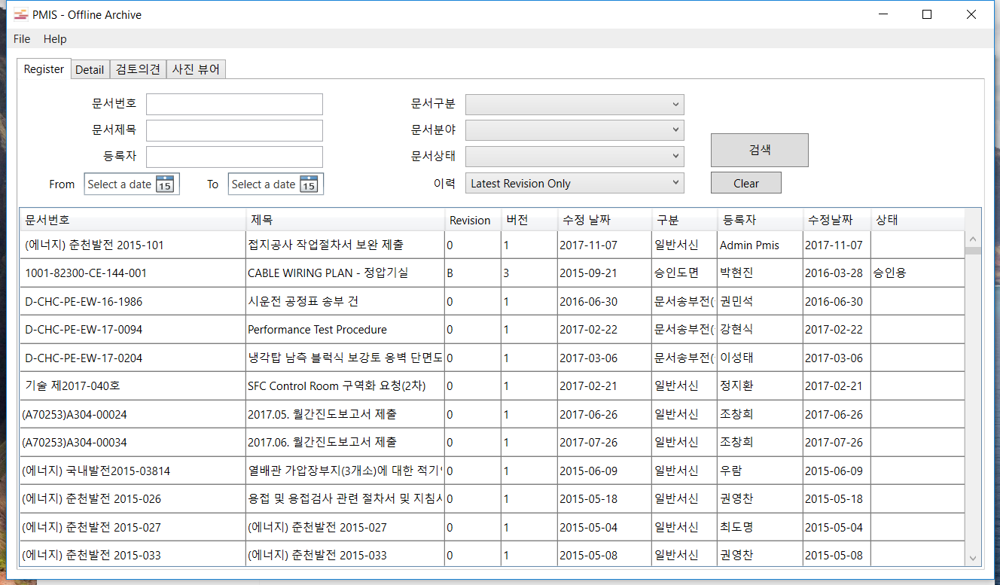
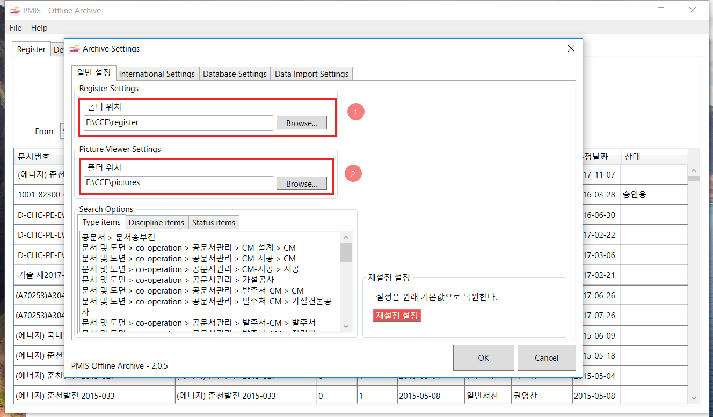
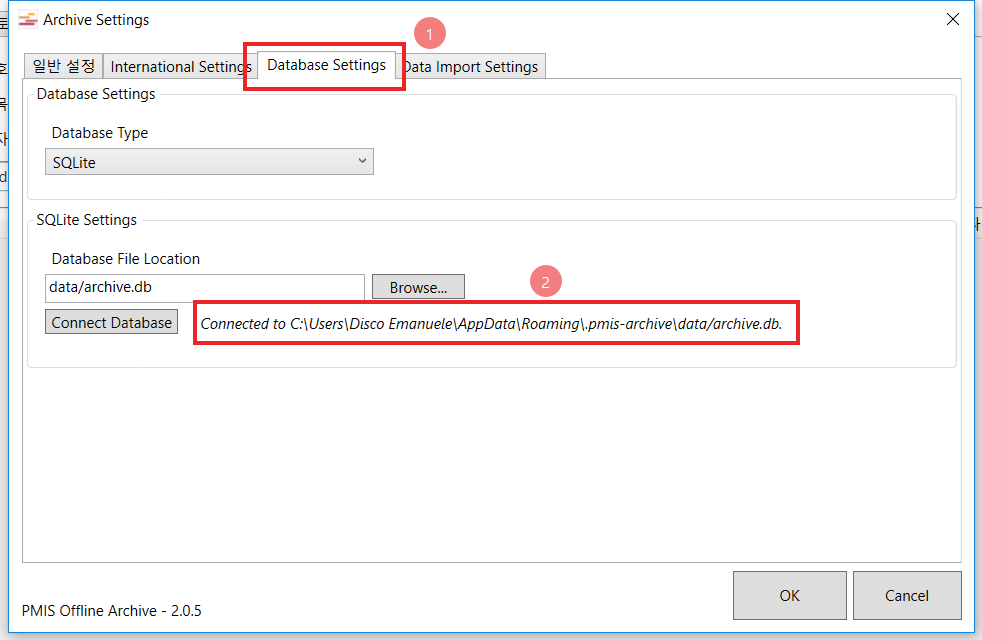
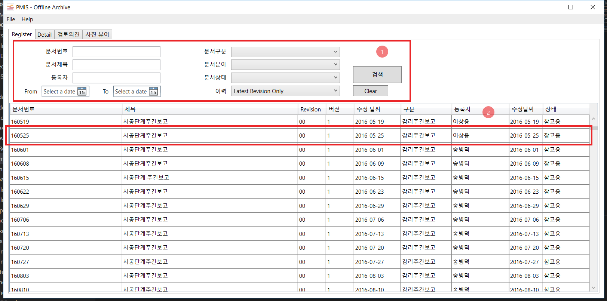
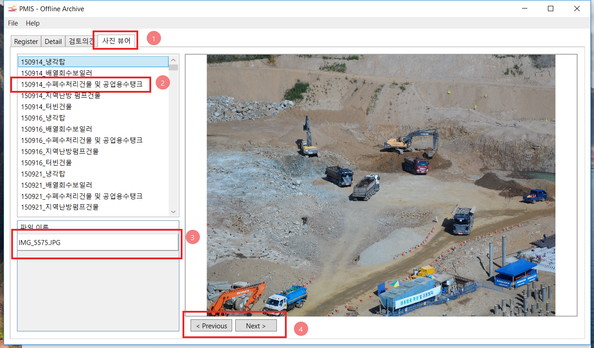

# PMIS 문서 오프라인 아카이브

프로젝트에서 사용된 PMIS(Project Management Information System)의 문서 등록대장(Register),
검토 이력(Review), 분류 체계, 첨부 파일/사진을 하나의 오프라인 패키지로 담아,
서버 접속 없이도 영구적으로 열람할 수 있도록 해주는 데스크톱 프로그램입니다.

## 처음 설정하기

아카이브를 사용하려면 최초 1회 설정이 필요합니다.
등록대장 폴더(Register Folder)와 사진 폴더(Picture Folder)를 프로그램에 연결해야 합니다.

메인 화면에서 `File/Settings` 메뉴로 이동합니다.

---

`General Settings`에서 등록대장 폴더와 사진 폴더 경로를 알맞게 지정합니다
(등록대장 폴더와 사진 폴더가 포함된 저장매체를 전달받았어야 합니다).

---

`Database Settings`에서는 `Connected to ...archive.db` 메시지가 표시되는지만 확인하면
됩니다. `archive.db`는 기본 제공 데이터베이스이며 별도로 변경할 필요가 없습니다.

메시지 내용이 다르거나 데이터베이스가 다른 경우, 지원팀에 문의하시면 올바른
데이터베이스로 설정을 도와드립니다.

---

설정이 모두 올바르게 되었다면 바로 아카이브를 사용할 수 있습니다.
데이터베이스를 변경한 후 목록에 데이터가 보이지 않는다면 검색(Search) 버튼을
눌러야 할 수 있습니다.

찾으시는 문서를 검색한 후, 결과를 더블클릭하면 상세 화면이 열립니다.

---

## 문서 등록대장 (Register) 탭

검색/필터 항목(문서번호, 제목, 상태, 공종/분야, 문서유형 등)으로 원하는 문서를
찾을 수 있습니다. 결과를 더블클릭하면 상세 화면이 열리며, 해당 문서 리비전에
연결된 첨부 파일 목록을 확인하고 열람하거나 탐색기에서 위치를 열 수 있습니다.

## 검토 이력 (Review) 탭

문서/리비전별 승인·검토 이력을 확인할 수 있습니다. 각 검토 건에 첨부된 검토
관련 파일도 별도의 파일 목록에서 열람할 수 있습니다.

## 사진 뷰어 (Picture Viewer)

왼쪽 목록에서 폴더를 선택하면 하단 목록에 해당 폴더의 사진이 표시됩니다.
`Previous`/`Next` 버튼을 사용하거나 왼쪽 하단 목록에서 파일명을 클릭하여
폴더 내 사진을 차례로 넘겨볼 수 있습니다.

## 아카이브 (Archive) 탭

등록대장과는 별도로 관리되는 아카이브 항목(설명/유형/메타데이터 등)을 검색·필터할
수 있습니다. 결과를 더블클릭하면 상세 창이 열립니다.

## 다국어 지원

프로그램은 English/한국어 두 언어를 지원하며, Settings 화면에서 언어를 변경할 수
있습니다.

## 제작

* **SangAh Solution Team**

## 라이선스

이 프로젝트는 Apache License를 따릅니다. 자세한 내용은 [LICENSE.md](LICENSE.md) 파일을
참고하세요.

## 크레딧

* Icons made by [Freepik](https://www.flaticon.com/authors/freepik) from www.flaticon.com
* Icons made by [Pixel Buddha](https://www.flaticon.com/authors/pixel-buddha) from www.flaticon.com
* Icons made by [Gregor Cresnar](https://www.flaticon.com/authors/gregor-cresnar) from www.flaticon.com
